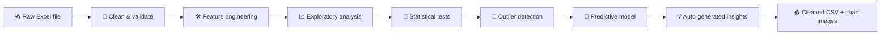

<div align="center">


<br>


<br>


<br>

**🧭 Jump to:**
[📌 Overview](#overview) ·
[📊 Dataset](#dataset) ·
[🧹 Cleaning](#cleaning) ·
[📈 Analysis](#analysis) ·
[🧪 Stats](#stats) ·
[🤖 Model](#model) ·
[💡 Findings](#findings) ·
[🚀 Run it](#run)

</div>

<br>

<a id="overview"></a>


Hospitals generate huge amounts of data, but raw records are rarely ready for decisions. This project takes a hospital admissions dataset of roughly **7,000 inpatient records** and runs the complete analyst workflow in Python:

| Step | What happens |
|:---:|---|
| 🧹 | **Clean & validate** the raw data (names, dates, types, quality checks) |
| 🛠️ | **Engineer features** that turn raw fields into business metrics |
| 📈 | **Explore** demand, revenue, stay length, insurance and patient feedback |
| 🧪 | **Test** whether differences seen in charts are statistically real |
| 🚨 | **Flag outliers** (very long stays, very high bills) without deleting real cases |
| 🤖 | **Model** whether length of stay can be predicted at admission |
| 📝 | **Summarise** findings automatically in plain language |

Everything lives in one documented Jupyter notebook, so each step can be read, re-run and extended.

<br>

<a id="questions"></a>


| # | ❓ Question | 📍 Where |
|:---:|---|---|
| 1 | How does demand change over time and by weekday? | Sections 5.1, 5.7 |
| 2 | Which diagnoses and bed types drive revenue? | Sections 5.2, 5.5 |
| 3 | What drives length of stay, and is billing just a function of stay? | Sections 5.3, 5.4 |
| 4 | How much of each bill do insurers actually cover? | Section 5.6 |
| 5 | What is linked to patient feedback? | Section 5.8 |
| 6 | How consistent are doctors, cities and age groups? | Sections 5.9 – 5.11 |
| 7 | Which cases are high-cost or long-stay outliers? | Section 7 |
| 8 | Can length of stay be predicted at admission? | Section 8 |

<br>

<a id="dataset"></a>


| 📌 Property | Detail |
|---|---|
| **Records** | 7,157 inpatient admissions |
| **Admission period** | December 2022 – March 2024 |
| **Original columns** | 21 |
| **Patient age** | Adults 18+, average ≈ 49 years |
| **Length of stay** | 1 – 45 days, average ≈ 8.2 days |
| **Billing amount** | ≈ 1,223 – 95,867 per patient, average ≈ 26,600 |
| **Feedback score** | 3.5 – 5.0, average ≈ 4.72 |

> [!NOTE]
> 💱 Currency is assumed to be **INR (₹)**. Change the `CUR` setting at the top of the notebook if different.

### 🗂️ Key Columns

| Column | Description |
|---|---|
| `patient_id` | Unique patient identifier |
| `admit_date` / `discharge_date` | Admission and discharge dates |
| `diagnosis` | Primary diagnosis |
| `bed_occupancy` | Bed type (e.g. General, Private, ICU) |
| `admission_type` | How the patient was admitted |
| `doctor` | Treating doctor |
| `insurance_provider` | Insurer covering the patient |
| `billing_amount` / `health_insurance_amount` | Total bill and insured portion |
| `los_days` | Length of stay in days |
| `feedback` | Patient rating (1–5 scale) |
| `city`, `gender`, `patient_age` | Patient demographics |

> [!IMPORTANT]
> 🔒 **Privacy by design:** the patient name column is **removed** during cleaning and is not needed for any analysis. The data appears to be synthetic / anonymised.

<br>

<a id="workflow"></a>




<br>

<a id="cleaning"></a>


| ✅ Step | What was done | 💡 Why it matters |
|---|---|---|
| **Standardised column names** | Converted to `snake_case`, removed double and trailing spaces | Consistent, code-friendly names |
| **Removed personal data** | Dropped the patient name column | Privacy best practice |
| **Fixed data types** | Converted admit/discharge dates to datetime | Enables date maths and time trends |
| **Repaired follow-up dates** | Kept valid dates, turned time-only values into missing | The column mixed dates with time-only entries |
| **Stripped whitespace** | Cleaned all text columns | Avoids "ICU" vs "ICU " duplicates |
| **Merged overlapping age columns** | Built one clean `age_group` from `patient_age` | Two original age columns were redundant |
| **Rebuilt missing stay lengths** | Calculated from discharge minus admission date | Stay length can be derived exactly |

### 🔍 Built-in Data-Quality Report

A validation table checks for problems before any analysis is trusted:

- 🔁 Duplicate rows and duplicate patient IDs
- ❓ Missing values per column
- ⏪ Discharge dates earlier than admission dates
- 🧮 Stay length that does not match the dates
- 💸 Insurance amount greater than the bill
- ⭐ Feedback outside the 1–5 range
- 📆 Follow-up dates earlier than discharge

<br>

<a id="features"></a>


| 🆕 New column | Meaning |
|---|---|
| `admit_ym` | Admission year-month for trend analysis |
| `admit_weekday` | Day of the week of admission |
| `is_weekend_admit` | Admitted on Saturday or Sunday |
| `age_group` | 18-29 · 30-44 · 45-59 · 60-74 · 75+ |
| `stay_category` | Short (1-3d) · Medium (4-7d) · Long (8-14d) · Very long (15d+) |
| `feedback_category` | Poor (≤4.0) · Good (≤4.5) · Excellent (>4.5) |
| `out_of_pocket` | Bill minus insurance amount |
| `coverage_pct` | Insurance amount as a % of the bill |
| `cost_per_day` | Bill ÷ length of stay |
| `days_to_followup` | Days between discharge and follow-up |

<br>

<a id="analysis"></a>


Instead of hundreds of generic charts, each chart answers **one specific question**. All charts are saved to the [`images/`](images/) folder.

| 📊 Chart | ❓ Question answered |
|---|---|
| 📅 Monthly admissions + average stay | How does demand change over time? |
| 💰 Diagnosis overview | Which diagnoses bring the most revenue? |
| 🛏️ Stay length by diagnosis | Which conditions keep patients longest? |
| 🔗 Billing vs length of stay | Is the bill just a function of days stayed? |
| 🏨 Bed type & admission type costs | Where does the money come from? |
| 🛡️ Insurance coverage | Who pays what, and does the insurer matter? |
| 🗓️ Weekday × admission-type heatmap | Which days are busiest? |
| ⭐ Feedback drivers | What is linked to patient satisfaction? |
| 👨‍⚕️ Doctor scorecard | How consistent are doctors? |
| 👥 Age × diagnosis heatmap | Which age groups face which conditions? |
| 🌆 City comparison | Where do patients come from? |
| 🔁 Follow-up timing | How soon do patients return? |

### 🖼️ Preview

| | |
|:---:|:---:|
|  |  |
|  |  |

> [!WARNING]
> ⚠️ **Data caveat caught during analysis:** the file only includes patients *discharged* after a certain date. Early admission months are therefore biased towards long stays, and the final month is incomplete. Trend charts use **complete months only**.

<br>

<a id="stats"></a>


Charts show *what* differs. Tests show whether the difference is **real**, and effect sizes show whether it **matters**. With thousands of rows even tiny differences become "significant", so both are reported.

| 🔬 Question | 🧰 Test | 📏 Effect size |
|---|---|---|
| Is billing related to stay length? | Spearman correlation | ρ |
| Does billing differ across diagnoses / bed types? | Kruskal-Wallis | ε² |
| Do weekend admissions differ in stay or feedback? | Mann-Whitney U | rank-biserial r |
| Does feedback differ by stay category? | Kruskal-Wallis | ε² |
| Is admission type linked to stay category? | Chi-square | Cramér's V |

<br>

<a id="outliers"></a>


One reusable function, `outlier_report()`, applies the **IQR rule** to any list of numeric columns. It returns a summary table **and** draws the box plots.

- 📏 Reports Q1, median, Q3, fences and outlier counts per column
- 🏷️ **Flags** extreme cases (`long_stay_flag`, `high_cost_flag`) instead of deleting them
- 🧠 Very high bills and very long stays are usually **real patients**, not errors

<br>

<a id="model"></a>


A small, honest machine-learning section:

- ✅ Uses **only information known at admission** (no billing, insurance or feedback, which would leak the answer)
- 📉 Compared against a **baseline** that always predicts the median
- 🌲 **Random Forest** with one-hot encoding in a scikit-learn pipeline
- 🔎 **Permutation importance** shows which inputs matter most
- 🗣️ Results are reported exactly as they are. If the model barely beats the baseline, that **is** a finding: stay length is then better planned from diagnosis-level averages than from individual predictions.

| Model | MAE (days) | R² |
|---|:---:|:---:|
| Baseline (median) | ✏️ *fill in* | ✏️ *fill in* |
| Random Forest | ✏️ *fill in* | ✏️ *fill in* |

<br>

<a id="findings"></a>


> [!TIP]
> ✏️ **Replace these with your real results.** Run the notebook's last cell, which prints findings generated from your data, then rewrite the best 4–6 in your own words with specific numbers.

1. 📅 **Demand:** *e.g. "Admissions peaked in [month] at X, with a monthly average of Y."*
2. 💰 **Revenue:** *e.g. "[Diagnosis] contributes X% of total billing."*
3. 🛏️ **Stay length:** *e.g. "[Diagnosis] patients stay longest at X days on average."*
4. 🛡️ **Insurance:** *e.g. "Coverage is about X% across all providers."*
5. ⭐ **Feedback:** *e.g. "X% of patients rate above 4.5, so feedback is heavily skewed to the top."*
6. 🚨 **Outliers:** *e.g. "X% of patients use Y% of all bed-days."*

### 🧭 Suggested Recommendations

- 👩‍⚕️ **Staffing:** align admission-desk staffing with the busiest weekdays
- 🛏️ **Capacity planning:** review discharge planning for diagnoses with the longest stays
- 💼 **Revenue:** protect the service lines with the highest billing share
- ⭐ **Patient experience:** focus improvement on the groups with the lowest scores

<br>

<a id="run"></a>


**1️⃣ Clone the repository**

```bash
git clone https://github.com/jaynilmistry184-sys/Hospital-data-cleaning-.git
cd "Hospital-data-cleaning-/Python project"
```

**2️⃣ Create a virtual environment** *(recommended)*

```bash
python -m venv venv
source venv/bin/activate        # macOS / Linux
venv\Scripts\activate           # Windows
```

**3️⃣ Install dependencies**

```bash
pip install pandas numpy matplotlib seaborn scipy scikit-learn openpyxl jupyter
```

**4️⃣ Launch the notebook**

```bash
jupyter notebook
```

Open the analysis notebook, set `DATA_PATH` in the first code cell to your Excel file, and run **Kernel → Restart & Run All**.

| 📤 Output | Description |
|---|---|
| `healthcare_cleaned.csv` | Cleaned dataset (patient names removed) |
| `images/*.png` | All charts, ready to embed in reports |

<br>

<a id="structure"></a>


> ✏️ Adjust the file names to match your folder exactly.

```text
Hospital-data-cleaning-/
│
└── Python project/
    ├── assets/                               # README banners (SVG)
    ├── images/                               # Saved charts
    ├── Healthcare_Analysis_Portfolio.ipynb   # Full cleaning + analysis notebook
    ├── Papollo_Healthcare_Enhanced.xlsx      # Source data (only if you may share it)
    ├── healthcare_cleaned.csv                # Cleaned output
    └── README.md
```

<br>

<a id="skills"></a>


| 🧩 Area | 🛠️ Detail |
|---|---|
| **Data cleaning** | Type fixing, missing-value handling, validation checks, privacy-aware column removal |
| **Feature engineering** | Business metrics, binning with `pd.cut`, date-derived features |
| **EDA & visualization** | Seaborn / Matplotlib charts, each tied to a business question |
| **Statistics** | Non-parametric tests, effect sizes, interpretation beyond p-values |
| **Outlier analysis** | IQR method in a reusable function |
| **Machine learning** | Pipelines, baselines, leakage avoidance, permutation importance |
| **Communication** | Auto-generated insights, executive summary, stated limitations |

<br>

<a id="limits"></a>


- 🧪 The data appears synthetic / anonymised, so conclusions illustrate a **method**, not real hospital performance
- 📆 Only discharged patients within a date window are included (selection bias at the start of the period)
- 🔗 Observational data: **correlation is not causation**
- 🩺 No clinical outcome variables (readmission, mortality, complications)

<br>

<a id="roadmap"></a>


- [ ] 📊 Build an interactive **Power BI / Tableau** dashboard from `healthcare_cleaned.csv`
- [ ] 🗄️ Load the cleaned data into **SQL** and answer the business questions with queries
- [ ] 🖥️ Turn the analysis into a **Streamlit** app
- [ ] 📅 Add forecasting of monthly admissions
- [ ] 🧾 Add a `requirements.txt` and `.gitignore`

<br>

<a id="author"></a>


<div align="center">

**Jaynil Mistry** · 📊 Data Analytics Portfolio Project

[](https://github.com/jaynilmistry184-sys)

Distributed under the **MIT License**

⭐ If you found this project useful, consider giving it a star!

</div>
